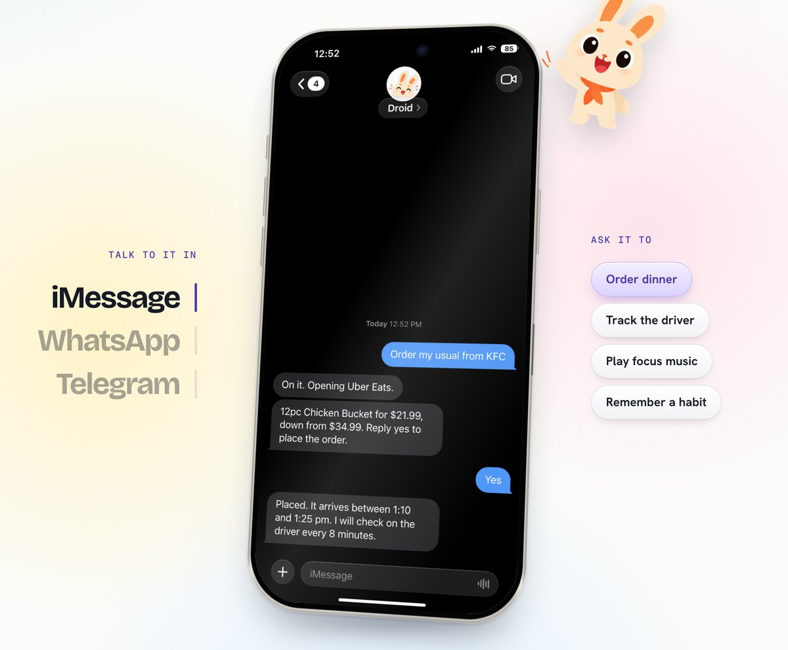
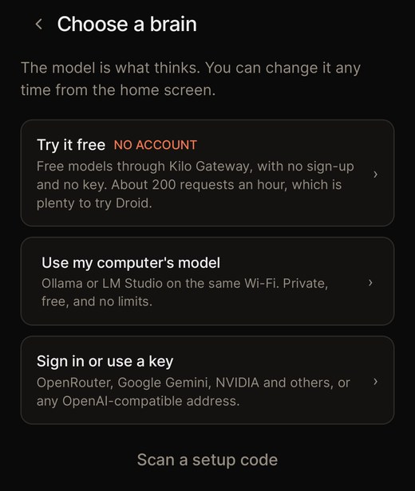
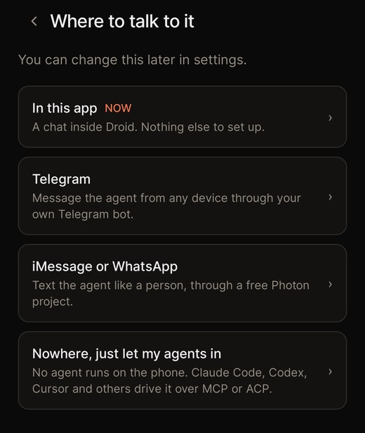
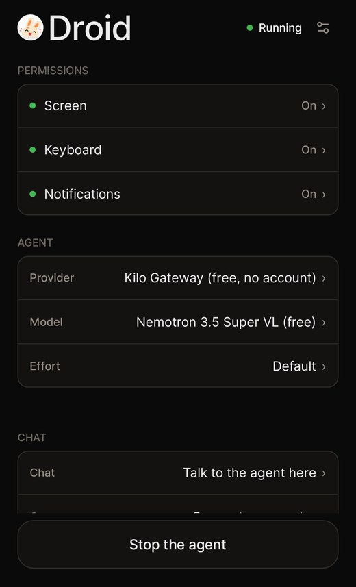
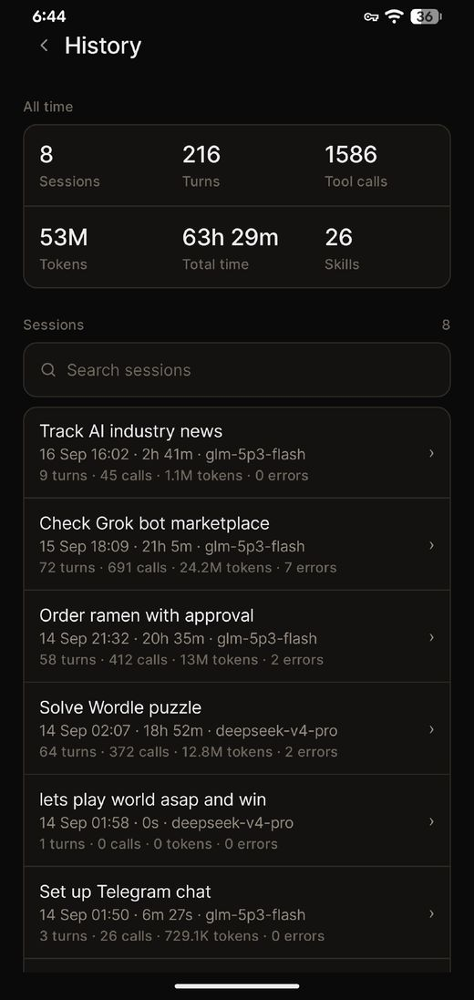
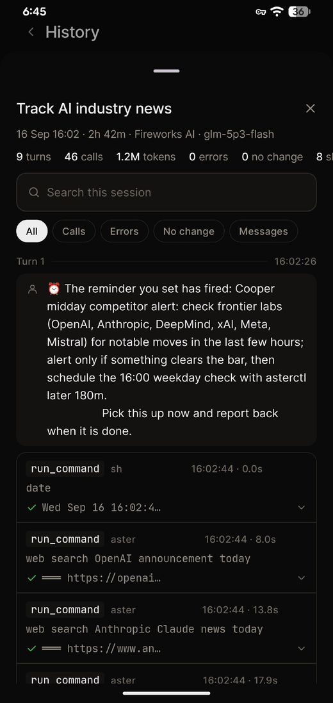
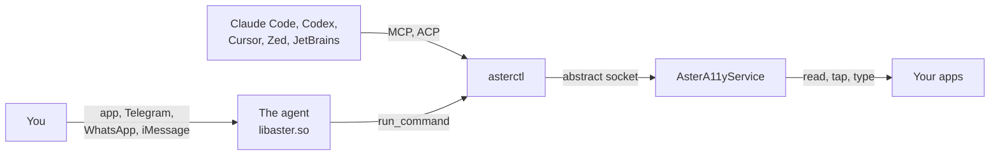

<div align="center">


# Droid

**Your phone. Any agent.**

An agent that uses your Android phone the way you do. Run it on any model,
free and local ones included, drive the phone from any agent over MCP and ACP,
and talk to it in the app, on Telegram, or on WhatsApp and iMessage through Photon.

[](https://github.com/Zfinix/droid/releases/latest)
[](https://www.android.com/)
[](https://github.com/Zfinix/droid)

**[Website](https://droid.withaster.dev)** · [Get the app](https://github.com/Zfinix/droid/releases/latest) · [Setup](docs/SETUP.md)



</div>

---

Droid (`dev.aster.probe`) gives an AI agent your phone's screen. An accessibility service lets it read, tap, swipe and type, in your apps, with your accounts.

- **Any model.** Free models with no account and no key, Ollama or LM Studio on your own computer, or a key for one of [40 providers](docs/PROVIDERS.md), such as OpenRouter, Gemini and NVIDIA.
- **Any agent.** Claude Code, Codex, Cursor and any other MCP client use the phone's screen as a tool. Zed and JetBrains talk to the agent on the phone over ACP.
- **Chat where you are.** In the Droid app, on Telegram, or on WhatsApp and iMessage through [Photon](https://photon.codes).

**Status:** used as a daily driver, still experimental. `arm64-v8a` only, and it needs broad device permissions.

## Quick start

1. Install the APK from the [latest release](https://github.com/Zfinix/droid/releases/latest) and open it.
2. Onboarding picks a model. **Try it free** needs no account and no key; you can also use a model on your computer or sign in with a provider.
3. Choose where to talk to it: the chat in the app, Telegram, or Photon.
4. Grant what it asks for: accessibility, the keyboard, notification access. Then say what you want done:

```txt
Open settings and turn on Do Not Disturb.
```

The free models run on a trial service that keeps logs, so keep them away from banking, health and other private screens. Use your own computer's model or a key for those.

## Connect a computer

MCP and ACP over USB, Wi-Fi or Tailscale are free and work today. In Droid, open **Connect a computer** and turn on Agents (MCP), Editors (ACP), or both. For Wi-Fi, also turn on Over Wi-Fi; for Tailscale, set Other agents' and Editors' address in settings to the phone's Tailscale address. Then on the computer:

```sh
npx @withaster/droid pair --adb               # phone on a USB cable
npx @withaster/droid pair --lan 192.168.1.20  # phone on this Wi-Fi, or its Tailscale address
npx @withaster/droid setup claude             # or codex, cursor, zed, jetbrains, vscode, all
```

`pair` asks for the keys Droid shows under Connect a computer. A bare `npx @withaster/droid pair` uses adb when it sees exactly one phone, and otherwise says how to pair over Wi-Fi. `setup` writes the config for each client. More in the [CLI README](cli/README.md).

**Aster Relay is coming soon.** It will reach the phone from anywhere with one code, with no ports, adb or Tailscale. Until it opens, use USB, Wi-Fi or Tailscale. A relay you host yourself works now: see [Self-hosting](docs/RELAY.md#self-hosting).

## What it can do

### Your apps. A new way to use them.

The agent reads the screen, taps, swipes, and types. Just say what you want to do:

```txt
Open settings and turn on Do Not Disturb.
```

### It remembers, and it learns

Save a fact with `/remember`, teach it a routine with `/learn`, and browse the collection with `/skills`. Installed skills show up as `/commands` too.

```txt
/remember I prefer a quiet phone after 10 pm
Saved to memory. Prefers a quiet phone after 10 pm.

/learn
New skill: quiet-mode
Opens Settings, turns on Do Not Disturb, and lowers ring volume.
```

### It comes back on its own

The agent schedules its own wake-ups, ends the turn, and returns when the timer fires. Rider checks, chunked recordings, anything that needs a later look. Manage them from the chat with `/checkins` and `/cron`.

### Watch it work. Take over whenever.

Use `/mirror` to open your phone's live screen in a browser, over your LAN or Tailscale. Tap, type, and control it yourself.

### Your choice of model

Start on free models with no key, connect a cloud provider, or use a model server on your own computer, and change the model and reasoning effort from chat. 40 providers with key pages in [docs/PROVIDERS.md](docs/PROVIDERS.md); a local server needs no key.

<div align="center">

<table>
  <tr>
    <td></td>
    <td></td>
  </tr>
</table>

</div>

### Bring your own agent

The phone is not tied to the agent on it. Claude Code, Codex, Cursor, or any tool that speaks MCP can read and use the screen too, and Zed and JetBrains can chat with the phone's agent over ACP. Pair once and let `setup` write each client's config, as in [Connect a computer](#connect-a-computer). Your agent gets the same eyes and hands.

You can also swap the agent that runs on the phone for your own command. Details in [docs/USING.md](docs/USING.md#any-harness).

### The little things, thought through

- **Pick up a conversation**: list past sessions, resume your work, or start fresh
- **Stop or try again**: cancel a running turn, retry the last message, see the queue
- **See what happened**: agent status, tool activity, and transcripts in the app
- **Choose who can ask**: on Telegram, WhatsApp or iMessage, set Allowed people; the agent ignores everyone else

<div align="center">



</div>

### It gets better at your phone

After a run it scores its own rounds, keeps the shortest path, and saves it as a skill. The next time is faster. The History screen keeps the receipts: sessions, turns, tool calls, tokens.

<div align="center">

<table>
  <tr>
    <td></td>
    <td></td>
  </tr>
</table>

</div>

## Documentation

| doc | what is in it |
| --- | --- |
| [SETUP](docs/SETUP.md) | Telegram in detail, configuring from a computer, configuration variables, troubleshooting |
| [PROVIDERS](docs/PROVIDERS.md) | all 40 providers with key pages and env variables |
| [USING](docs/USING.md) | chat commands, the control protocol, action receipts, the screen mirror, other agents over MCP |
| [CLI](cli/README.md) | `@withaster/droid`: pairing a computer, `setup` for each client, the stdio MCP and ACP bridges |
| [RELAY](docs/RELAY.md) | the relay protocol, for Aster Relay (coming soon) or one you host |
| [ARCHITECTURE](docs/ARCHITECTURE.md) | how it works, with a diagram |
| [LICENSE](LICENSE) | Apache-2.0 |
| [BUILDING](docs/BUILDING.md) | build from source, releases, CI, permissions, repository layout |

## The short version of how it works

A foreground service runs the agent as a child process, with a bridge to Telegram or Photon when one is chosen. The agent calls `asterctl`, which talks to `AsterA11yService` over an abstract Unix socket; the service reads accessibility trees, dispatches gestures and captures screenshots. Other agents reach the same service through `asterctl mcp`, and editors reach the agent through `asterctl acp`. Full detail in [docs/ARCHITECTURE.md](docs/ARCHITECTURE.md).


