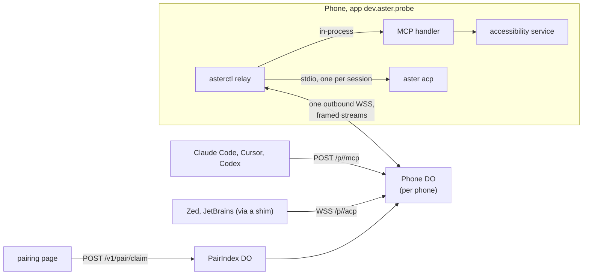

# Aster Relay

## What it is

Aster Relay lets an MCP client or an ACP editor reach a phone running Droid from anywhere, with no open port, no Tailscale and no adb. The phone dials out to the relay over one WebSocket and keeps it open. Clients talk to the relay over HTTPS, and the relay carries each request down that socket.

There are two ends:

- **The phone's end** is `asterctl relay` (`client/src/relay.rs`), a long-running child of the app. MCP calls run in-process through the same handler as `asterctl mcp`; ACP sessions each start an `aster acp` child, exactly as `asterctl acp --ws` does.
- **The relay** is a Cloudflare Worker with Durable Objects (`relay/`). Each phone gets one `Phone` object, named by its phone id. Short codes and client-QR nonces live in a `PairIndex` object, sharded by their first two characters.



The relay is free software like the rest of Droid. The hosted copy at `relay.withaster.dev` is the paid "Aster Relay" ($5 a month); anyone can run the same Worker on their own Cloudflare account for nothing (see [Self-hosting](#self-hosting)).

## Routes

| Method | Path | Who | What |
| --- | --- | --- | --- |
| GET (WebSocket) | `/p/<phoneId>/link` | the phone | The link. Header `X-Aster-Pub: <b64url ed25519 public key>` |
| POST | `/p/<phoneId>/mcp` | MCP client | Streamable HTTP, one JSON-RPC message per request. `Authorization: Bearer <client token>` |
| GET, DELETE | `/p/<phoneId>/mcp` | | 405, as `asterctl mcp --http` answers |
| GET (WebSocket) | `/p/<phoneId>/acp` | ACP client | One text message per JSON-RPC line. Bearer token in `Authorization` or as subprotocol `bearer.<token>` |
| GET | `/p/<phoneId>/status` | paired client | `{"online","last_seen","plan","entitled","app"}` |
| POST | `/v1/pair/claim` | pairing page, CLI | Trade a short code for a token (pairing b1) |
| GET | `/v1/pair/wait/<nonce>` | CLI that showed a QR | Long-poll for the phone's scan (pairing b2) |
| POST | `/v1/admin/entitlement` | operator | Test switch, only when `ADMIN_SECRET` is set |
| GET | `/pair`, `/claim` | a person | The code-entry page, and the page a client QR opens in a browser |
| GET | `/health` | monitoring | `{"ok":true}` |

Phone ids match `ph_[a-z2-7]{26}`. Anything else under `/p/` is a 404 from the static assets.

## Identity and the link

On first start `asterctl relay` generates an Ed25519 key and writes it to `$HOME/.aster/relay/device.json` (mode 0600, directory 0700), with the phone id next to it. On the phone `$HOME` is the app's files directory.

```
phoneId = "ph_" + base32lower(sha256(ed25519_pub))[:26]     (130 bits, RFC 4648 alphabet, no padding)
```

The id is a hash of the key, so there is no registration and no account: nobody else can produce a key that hashes to it.

Link authentication is challenge and response, with no clocks:

1. The phone opens `wss://<relay>/p/<phoneId>/link` with `X-Aster-Pub`. The relay refuses with 403, before upgrading, if the key does not hash to the id.
2. The relay accepts the socket with the Hibernation API and sends `CTRL {"t":"challenge","nonce":"<32 random bytes, b64url>","host":"<relay host>"}`.
3. The phone checks that `host` is the host it dialled, then answers `CTRL {"t":"auth","sig":"<b64url Ed25519 signature>","app":"<version>","abi":"aarch64"}` over the bytes of

   ```
   aster-relay/v1/link\n<phoneId>\n<nonce>\n<host>
   ```

4. The relay verifies with `crypto.subtle.verify("Ed25519")`. On success it closes any older authenticated link with 4001 `replaced` and sends `CTRL {"t":"ready","plan","entitled","limits","clients"}`. The connector prints `relay: online <phoneId>`.
5. A wrong or missing signature, or any other frame first, closes the socket with 4401. A socket that has not signed within 10 s is closed by an alarm. An unauthenticated socket never displaces the live link.

Signing the host means a relay cannot pass another relay's challenge through to the phone and log in there as it.

Keepalive: the phone sends the text message `ping` every 25 s. The relay answers `pong` with `setWebSocketAutoResponse`, which does not wake the Durable Object, so an idle phone costs nothing. When the link drops the connector prints `relay: offline <reason>` and redials with full-jitter backoff from 1 s up to 60 s, starting over at 1 s after a link that lasted a minute.

`ASTER_RELAY_URL` must be `https://`. Plain `http://` is accepted only for `localhost`, `127.0.0.1` and `10.0.2.2` (the emulator's host), for development.

## Framing

Every binary WebSocket message on the link is one frame:

```
u8 kind | u32 big-endian stream | payload
```

| Kind | Name | Direction | Payload |
| --- | --- | --- | --- |
| `0x00` | CTRL | both | UTF-8 JSON, always stream 0 |
| `0x01` | OPEN | relay to phone | JSON `{"svc","client","scopes",...}` |
| `0x02` | DATA | both | Raw body bytes, at most 256 KiB per frame |
| `0x03` | HEAD | phone to relay | JSON `{"status":200,"headers":{"content-type":"application/json"}}` |
| `0x04` | END | both | Empty. The stream is finished |
| `0x05` | RESET | both | JSON `{"code","reason"}`. The stream is abandoned |
| `0x06` | WSMSG | both | A tunnelled WebSocket message: byte 0 is `0` for text or `1` for binary, then the data |
| `0x07` | CREDIT | both | u32 BE bytes the receiver will accept. Reserved for the mirror tunnel |

The relay allocates odd stream ids and the phone even ones, so the two never collide. A receiver ignores kinds it does not know and frames for streams it does not have. Text messages on the link are only `ping` and `pong`.

Bodies are cut into 256 KiB DATA frames, so a 6 MiB screenshot (about 8 MiB as base64 JSON) is about 33 frames and never holds up another stream for long.

The codec lives twice, in `client/src/frame.rs` and `relay/src/frame.ts`. Both test suites read the same golden vectors from `relay/test/frame-vectors.json`, which also pins the phone id derivation, the fingerprint and a link signature made from the RFC 8032 test key. Change the format in both places and regenerate the vectors, or neither suite passes.

### An MCP call

1. The relay checks the client token, its scopes (`phone:read` or `phone:act`) and the phone's entitlement.
2. It sends `OPEN {"svc":"mcp","client":"c_…","scopes":[…],"method":"POST","path":"/mcp","headers":{"mcp-protocol-version":…}}`, the body as DATA frames, then END.
3. The phone re-checks the client and scopes against its own list, runs the request through `mcp::handle_as`, and answers HEAD, DATA and END. A notification gets HEAD with status 202 and no body.
4. The relay waits up to 125 s, five more than `asterctl` gives the longest verb.

Failures reach the agent as JSON-RPC errors with HTTP 200, so it can read why instead of seeing a transport failure:

| Case | Error |
| --- | --- |
| Phone offline | `-32000 the phone is offline (last seen 3m ago); open Droid on it` |
| No answer in 125 s | `-32000 the phone did not answer within 125s; read the screen before trying again`, and RESET `timeout` to the phone |
| Phone refused the stream | `-32000 <the phone's reason>` |
| Eight calls already in flight | `-32000 the phone is already answering 8 calls; try again in a moment` |
| Not entitled | `-32001 Aster Relay is not active for this phone; turn it on in Droid's settings` |

A missing or wrong token is HTTP 401 with `WWW-Authenticate: Bearer`; a body over 1 MiB is 413.

### An ACP session

1. The client opens `wss://<relay>/p/<phoneId>/acp`. A browser, which cannot set headers on a WebSocket, sends the token as the subprotocol `bearer.<token>`, and the relay echoes that subprotocol back.
2. The relay checks the token and the `agent:chat` scope, then sends `OPEN {"svc":"acp","client","scopes"}`.
3. Each text message from the client becomes WSMSG to the phone, and each WSMSG back becomes a text message to the client.
4. On the phone the connector takes the driver lease and starts `aster acp --permission-mode auto` in `$HOME`, rewriting `session/new` and `session/load` on the way in (see [Local ACP](#local-acp)).
5. Close codes the client can see:

| Code | Meaning |
| --- | --- |
| 1000 | The agent ended the session |
| 1011 | The phone could not start the agent |
| 4401 | The client was revoked while connected |
| 4402 | Aster Relay is not active for this phone |
| 4403 | The phone refused this client |
| 4409 | `busy`: another editor is driving the phone |
| 4503 | The phone is offline, or went offline |

When the client closes, the relay sends END on the stream and the phone kills the agent.

## CTRL messages

The phone's requests carry a `rid`, and the relay's reply carries the same `rid`. An error reply is `{"t":"error","rid","message"}`.

| Phone sends | Relay answers | What |
| --- | --- | --- |
| `auth {sig,app,abi}` | `ready {plan,entitled,limits,clients}` | Link login |
| `pair.open {scopes,ttl}` | `pair.code {code,exp}` | A short code, at most 300 s |
| `pair.approve {pending,ok}` | `ok` | The person's answer to `pair.claimed` |
| `client.add {id,nonce,noise_pub,name,kind,scopes}` | `client.added {client}` | The phone scanned a client QR |
| `client.list` | `clients {clients}` | `[{id,name,kind,scopes,created,last_seen}]` |
| `client.revoke {id}` | `revoked {ids}` | Revoke one client |
| `client.revoke_all` | `revoked {ids}` | Revoke every client |

| Relay sends | What |
| --- | --- |
| `challenge {nonce,host}` | First message on every link |
| `pair.claimed {pending,name,kind,scopes,country,ua}` | Someone entered this phone's code; the phone must allow or deny |
| `entitlement {entitled}` | The entitlement changed |

## Pairing

### b1: the phone shows a code

1. In Droid the person taps Connect a computer. The app runs `asterctl relay pair`, which sends `pair.open` and prints

   ```json
   {"code":"7K2Q9MXD","exp":1761200300,"url":"https://relay.withaster.dev/pair#1.<phoneId>.<code>.<fp>"}
   ```

   The code is 40 random bits as 8 Crockford base32 characters. `fp` is `base32lower(sha256("aster-relay/v1/fp\n" + ed25519_pub))[:16]`; the pairing page checks it against the `phone_fp` the relay returns, so a relay answering for another phone is caught.
2. The client posts `POST /v1/pair/claim {"code","phone"?,"client":{"name","kind"}}`. Case, dashes and the look-alikes O, I and L are forgiven.
3. The code is burned on this first claim, whatever happens next. An unknown code, an expired code and a code for another phone all return the same 404 `{"error":"invalid_or_expired"}`.
4. The relay sends `pair.claimed` and the connector prints `relay: approve <pendingId> <json>`. The app asks "Allow Claude Code on mbp?", then runs `asterctl relay approve <pendingId> yes|no`.
5. On yes, the claim returns 200:

   ```json
   {"phone_id":"ph_…","client_id":"c_…","token":"ast_c_c_…_…","scopes":["phone:act","agent:chat"],"phone_fp":"…",
    "endpoints":{"mcp":"https://relay.withaster.dev/p/ph_…/mcp","acp":"wss://relay.withaster.dev/p/ph_…/acp","mirror":null},
    "snippets":{"claude":"claude mcp add --transport http phone … --header \"Authorization: Bearer …\"","codex":"…","cursor":{…},"vscode":{…},"windsurf":{…},"zed":{…},"mcp_json":{…},"acp":{…}}}
   ```

   A no is 403, no answer within 120 s is 408, an offline phone is 503, a phone with 20 clients is 409.

The phone writes the client to its own `clients.json` before telling the relay yes, so the client's first call, which can arrive straight after, is not refused.

### b2: the client shows a QR

1. A CLI shows a QR for `https://relay.withaster.dev/claim#1.<client_pub b64url>.<nonce, 128 bits b64url>.<name b64url>` and long-polls `GET /v1/pair/wait/<nonce>`. A 408 means not yet; ask again.
2. The phone scans it in Droid; scanning is the consent, so there is no second prompt. The app runs `asterctl relay add <link>`, which picks the client id itself, saves the client, and sends `client.add`.
3. The relay mints the token and hands the same JSON as b1 to the waiting client. A result that arrives before the client waits is kept for 5 minutes and handed out once. A nonce is single-use.

## Client tokens and scopes

A token is `ast_c_<clientId>_<secret>`: the client id is `c_` and 10 base32 characters, the secret 32 base62 characters (190 bits). The fixed prefix lets secret scanners catch a leaked token. The relay stores only `sha256(secret)`, looks the client up by id, and compares hashes with `crypto.subtle.timingSafeEqual`. `last_used` is written at most once a minute.

| Scope | Allows |
| --- | --- |
| `phone:read` | MCP, limited to `map find shot ocr notes alerts apps wait help` (enforced in `mcp.rs`) |
| `phone:act` | MCP, every verb |
| `agent:chat` | ACP with the phone's own agent |
| `mirror:view`, `mirror:control` | Reserved for the mirror tunnel |

The default for a new code is `phone:act` and `agent:chat`. The relay passes scopes in OPEN, and the phone cuts them down to what it approved itself. A client the phone never approved gets RESET `forbidden`, whatever the relay says.

Revoking marks the client's row and closes its open sockets at once with 4401; its next request is a 401.

## Entitlement

`entitled = BILLING == "off" || meta.entitled == "1"`, checked on every pairing, call and session, and pushed to the phone in `ready` and `entitlement`. `BILLING="off"` is the default in `wrangler.jsonc`, so a self-hosted relay entitles every phone. Billing (Stripe) is not built yet; until it is, `POST /v1/admin/entitlement {"phone","entitled"}` with `Authorization: Bearer <ADMIN_SECRET>` flips the flag for testing. Without an `ADMIN_SECRET` of at least 32 characters that route is a 404.

## Limits

| Limit | Value |
| --- | --- |
| MCP body | 1 MiB |
| Reply from the phone | 16 MiB |
| MCP wait | 125 s |
| Calls in flight per phone | 8 |
| Clients per phone | 20 |
| Pairing code lifetime | 300 s |
| Claim waits for Allow | 120 s |
| Link must sign within | 10 s |
| Requests per client | 60 a minute (`RL_CLIENT`) |
| Claims and waits per IP | 10 a minute (`RL_CLAIM`) |
| Link dials per IP | 20 a minute (`RL_LINK`) |

They live in `relay/src/limits.ts` and `wrangler.jsonc`.

## Local ACP

`asterctl acp --ws [port] [--bind ip]` serves the same bridge on the phone itself, with no relay, at `ws://127.0.0.1:7072/acp` by default.

- `ASTER_ACP_TOKEN` must be set to at least 32 characters, or it exits saying so. The token goes in `Authorization: Bearer` or as subprotocol `bearer.<token>`, compared in constant time.
- An `Origin` that is not localhost gets 403, since a web page can open a socket to a local port. Editors send no Origin.
- Each authenticated socket starts `$ASTER_BIN acp --permission-mode auto` (`aster` on `PATH` when `ASTER_BIN` is unset) in `$HOME`, and pumps one JSON-RPC line per text message both ways.
- On `session/new` and `session/load` it sets `params.cwd` to `$HOME`, because the editor's project path does not exist on the phone and `aster acp` canonicalizes it, and it drops `mcpServers` entries that are not `http` or `sse`, because a stdio server would try to start a desktop binary on the phone.
- One editor drives the phone at a time. A second socket is accepted and closed with 4409 `busy`. The lease is shared with the relay connector through the abstract socket name `aster-acp-driver-<uid>`, which the kernel frees if the holder dies.
- The child is killed when the socket closes, and the socket is closed when the child exits.

## The connector's control socket

The app drives `asterctl relay` through one-shot verbs, which connect to the abstract unix socket `@aster-relay`, write one JSON line and print the one JSON line that comes back. The exit code is 1 when the reply has an `error`.

| Verb | Prints |
| --- | --- |
| `asterctl relay` | Runs the connector. Stdout lines: `relay: online <phoneId>`, `relay: offline <reason>`, `relay: approve <pendingId> <json>` |
| `asterctl relay status` | `{"online","phone_id","url","entitled"}`; still answers, offline, when the connector is not running |
| `asterctl relay pair [--scopes a,b] [--ttl s]` | `{"code","exp","url"}` |
| `asterctl relay clients` | `[{"id","name","kind","scopes","created","last_seen"}]` |
| `asterctl relay revoke <id\|all>` | `{"revoked":[ids]}` |
| `asterctl relay approve <pendingId> yes\|no` | `{"ok":true,"client","allowed"}` |
| `asterctl relay add <claim link>` | `{"ok":true,"client":{…}}` |

An abstract socket has no file permissions, so any app could connect to it. The connector checks the peer's uid (`SO_PEERCRED`) and drops any connection that is not its own app's. On hosts without abstract sockets (macOS, for development) it uses `/tmp/aster-relay-<uid>.sock` instead.

| Variable | Default | Read by |
| --- | --- | --- |
| `ASTER_RELAY_URL` | `https://relay.withaster.dev` | `asterctl relay` |
| `ASTER_ACP_TOKEN` | none, required | `asterctl acp --ws` |
| `ASTER_BIN` | `aster` on `PATH` | both, to start the agent |
| `HOME` | | both: the agent's directory and `.aster/relay/` |

## Threat model

Whoever holds a client token controls the phone: calls, messages, money. Everything below follows from that.

**What the relay sees.** This is Tier A in the design: TLS from each end to Cloudflare, not end to end. The relay and Cloudflare can read MCP calls and replies, screenshots and ACP messages as they pass. The relay keeps no bodies: it stores client names, kinds, scopes, hashed secrets and timestamps, and its logs carry only request metadata. The pairing page says this plainly. People who need more should self-host. End-to-end encryption (Noise IK between the phone and a desktop shim, Tier B) is designed in the research notes and not built.

**What a malicious relay could do.** Read and replay traffic, and use any token it was given. It cannot:

- log in as the phone elsewhere, because the signature covers the relay's host;
- invent a client or widen one's scopes, because the phone checks every stream against its own approved list;
- pair a client without the phone's yes for b1, or without a scan for b2;
- take over a phone id, because the id is the hash of the phone's key.

**What a network attacker could do.** Nothing beyond what TLS allows. `http://` relays are refused except on loopback.

**What another app on the phone could do.** Connect to `@aster-relay` or `@aster-acp-driver-<uid>`. The control socket checks the peer's uid, so it cannot pair or approve. It could squat the lease name to make ACP report busy; that is a denial of service, not a takeover.

**Guessing.** A code is 40 bits, single-use, lives 5 minutes and needs a yes on the phone; claims are limited to 10 a minute per IP. Tokens are 190 bits. A client-QR nonce is 128 bits and single-use.

**Shoulder surfing.** Someone who reads the code still needs the phone's owner to tap Allow, and the prompt shows the client's name, user agent and country.

**Leaks and loss.** Revoke one client or all of them from the phone, effective at once. Removing `$HOME/.aster/relay/device.json` gives the phone a new id and orphans every client.

**Replay.** Codes, nonces and link challenges are single-use. Bearer tokens can be replayed by design; their mitigations are TLS, scopes and instant revocation.

**Not done yet.** The "5 wrong attempts burn the code" rule from the design is not implemented: codes are already single-use and rate-limited, but a phone id given with a wrong code does not count against that phone. There is no recovery code or kill switch, no per-client expiry, and no OAuth for claude.ai and ChatGPT connectors.

## Self-hosting

The same Worker runs on any Cloudflare account, and with `BILLING="off"` every phone is entitled. SQLite-backed Durable Objects are available on the Workers Free plan; check the current daily quotas before relying on it for heavy use.

```sh
cd relay
npm install
npx wrangler login
npx wrangler deploy
```

That prints `https://aster-relay.<account>.workers.dev`. On the phone, set `ASTER_RELAY_URL` to it (Settings in Droid, or the `relay.url` field of a setup link). A custom domain is optional: add a `routes` entry in `wrangler.jsonc` like the commented one. `routes` stays commented in the repository so a deploy from a checkout never claims `relay.withaster.dev`.

Optional settings:

| Name | Kind | Use |
| --- | --- | --- |
| `BILLING` | var | `off` (default) entitles every phone |
| `RELAY_HOST` | var | The host phones sign for. Empty means the request's own host; set it if a proxy rewrites `Host` |
| `ADMIN_SECRET` | secret | Enables `/v1/admin/entitlement`. `npx wrangler secret put ADMIN_SECRET` |

Without a Cloudflare account, `relay/Dockerfile` runs the Worker under `workerd` through `wrangler dev`, with state on a volume at `/data`. Put any TLS proxy in front of it; the phone refuses plain `http://` to anything but loopback.

```sh
docker build -t aster-relay relay
docker run -d --restart always -p 8787:8787 -v aster-relay:/data -e RELAY_HOST=relay.example.com aster-relay
```

Set `RELAY_HOST` to the public host the phone dials, since the proxy in front may not pass it through.

## Testing

```sh
cd client && cargo test        # frame vectors, identity, acp --ws, the connector against a fake relay
cd relay && npm test           # the Worker in workerd, with a fake phone that signs with a real key
cd relay && npx tsc --noEmit
```

To try both ends together on a laptop:

```sh
cd relay && npx wrangler dev --port 8787
HOME=/tmp/phone ASTER_RELAY_URL=http://127.0.0.1:8787 asterctl relay
HOME=/tmp/phone asterctl relay pair
```

Then enter the code at `http://127.0.0.1:8787/pair` and answer with `asterctl relay approve <pendingId> yes`. One local quirk: under `wrangler dev`, a close the relay starts (4409, 4503) reaches the client at once, but some clients only report it when the dev proxy drops the TCP connection about 10 s later. The Worker tests and raw frames show the close itself on time.

## Not built yet

- The mirror tunnel (`/p/<id>/mirror/`, tickets, CREDIT flow control). OPEN with `svc:"mirror"` gets RESET `unsupported`, and `endpoints.mirror` is `null`.
- End-to-end encryption (Tier B), and the desktop shim that would carry it.
- Billing, OAuth 2.1 for URL-only connectors, webhook passthrough, recovery codes.
